# 城市光场｜整套图片预览 v1

封面＋12页正文，共13页。按用户选定方向B制作，本轮交付图片预览。

[查看PDF合集](city-light-full-preview.pdf) · [查看全套缩略图](contact-sheet.jpg)

公司简介按用户截图内容重新编排。技术纪录页本轮采用数据版式，尚未嵌入聊天提供的两张实拍图；图像原文件未随当前工作区提供。纪录名称与主体署名按大纲转录，不以图片单独证明我司纪录归属。

经营数字、引用及公司关系均按用户材料转录，本次未独立核验外部来源。来源编号对应原始DOCX。完整口径及演讲补充以原始大纲为准。

## 封面｜封面｜金鸡湖低空融媒合作方案

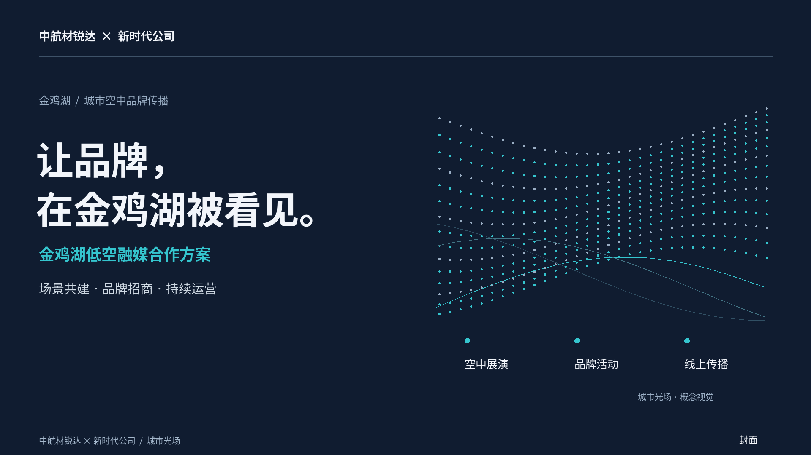

## P01｜共同经营金鸡湖低空融媒商业价值

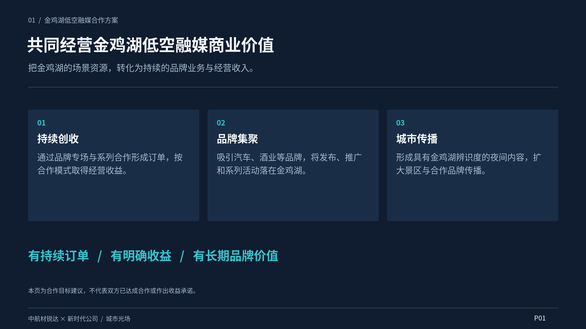

## P02｜空中展演＋品牌活动＋线上传播

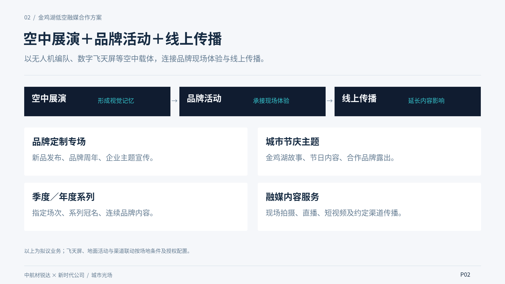

## P03｜品牌预算与付费案例证明商业需求

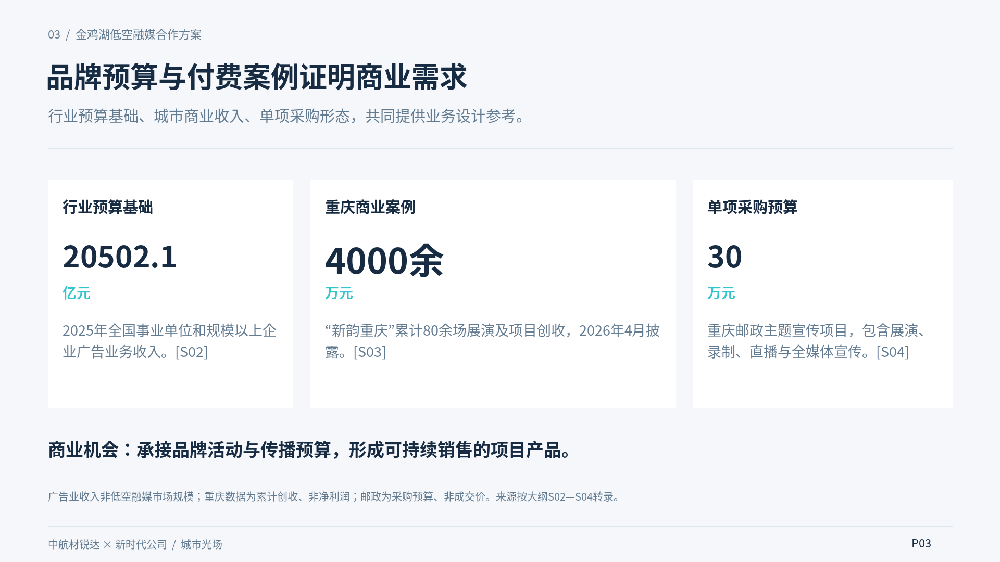

## P04｜四类合作产品，把展演转化为采购

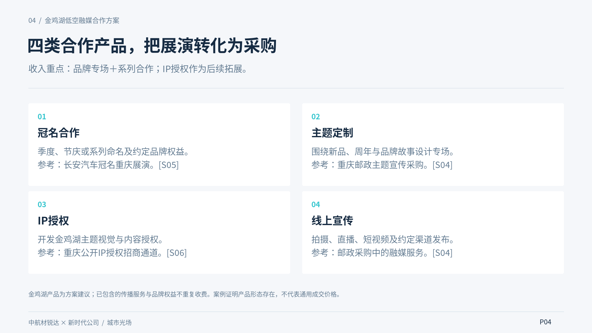

## P05｜公司简介与央企产业背景

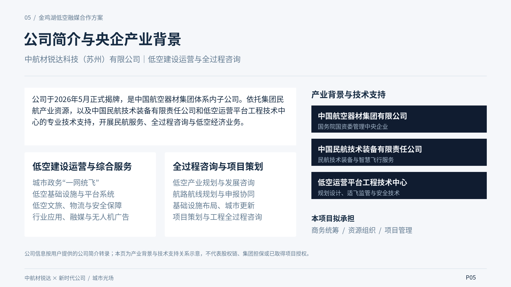

## P06｜技术规模与设计运营能力

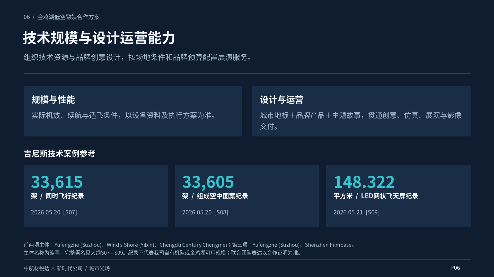

## P07｜聚焦汽车与酒业，导入品牌业务

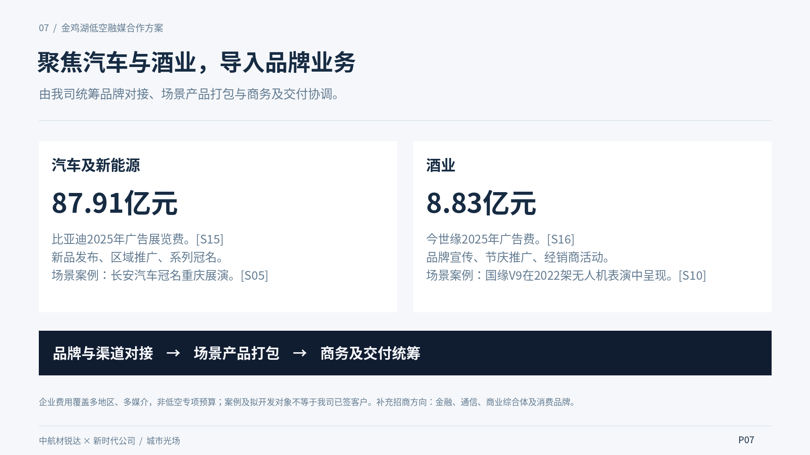

## P08｜三种合作方式，匹配资源与收益

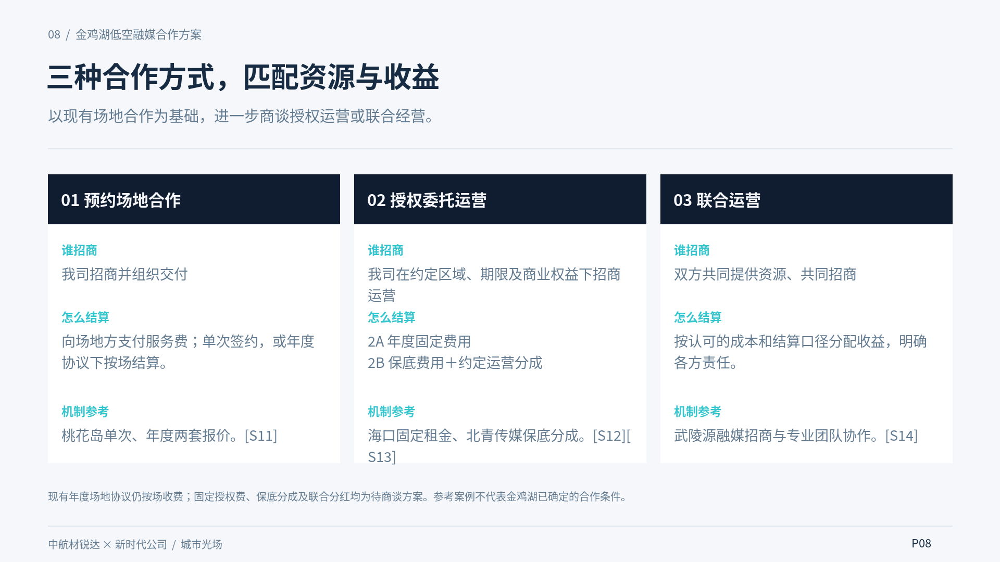

## P09｜以场地方报价明确合作成本

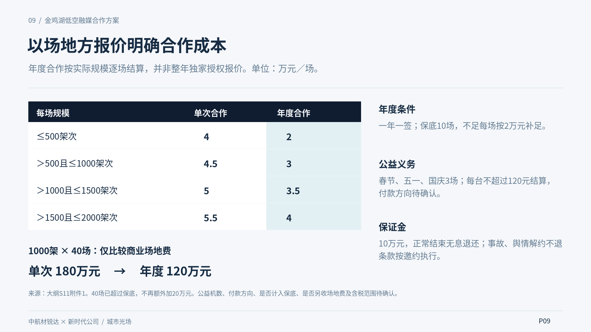

## P10｜打造年创收千万元级低空融媒项目

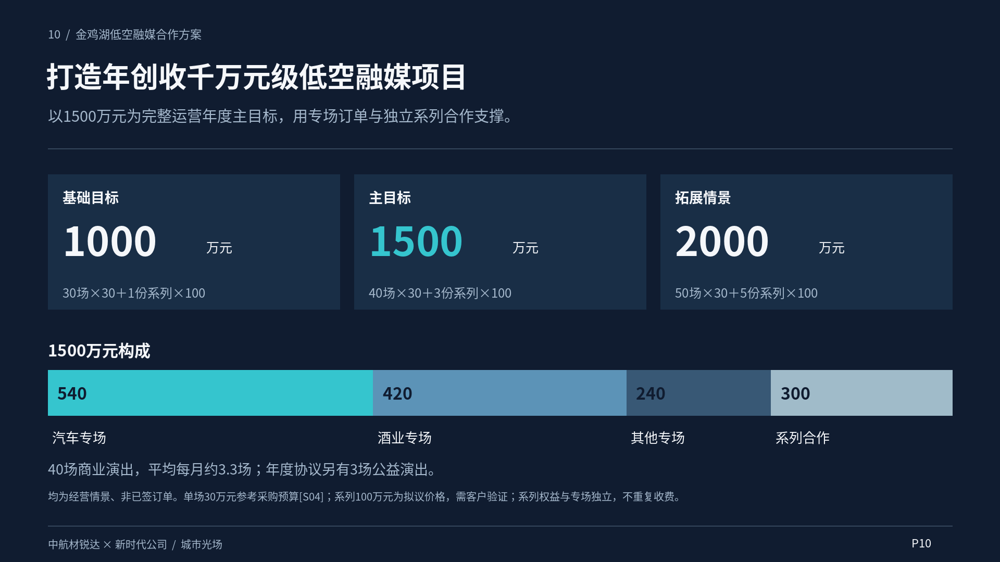

## P11｜按场地方报价核算双方收益

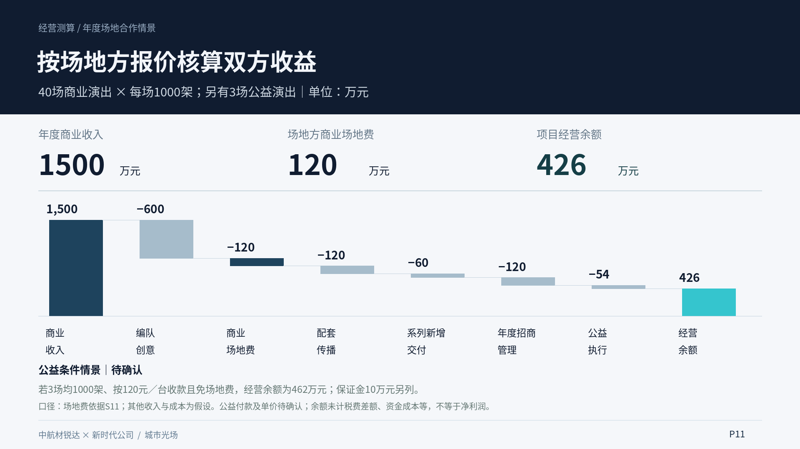

## P12｜明确年度合作的资源与商务条件

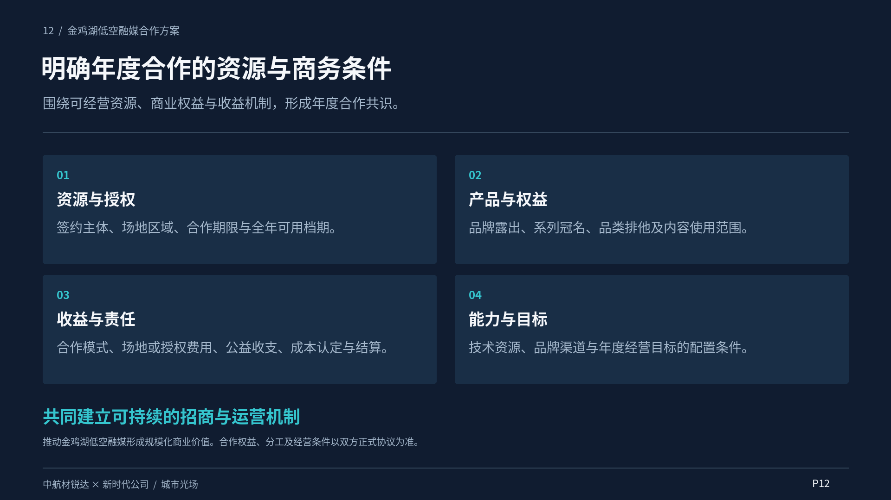
