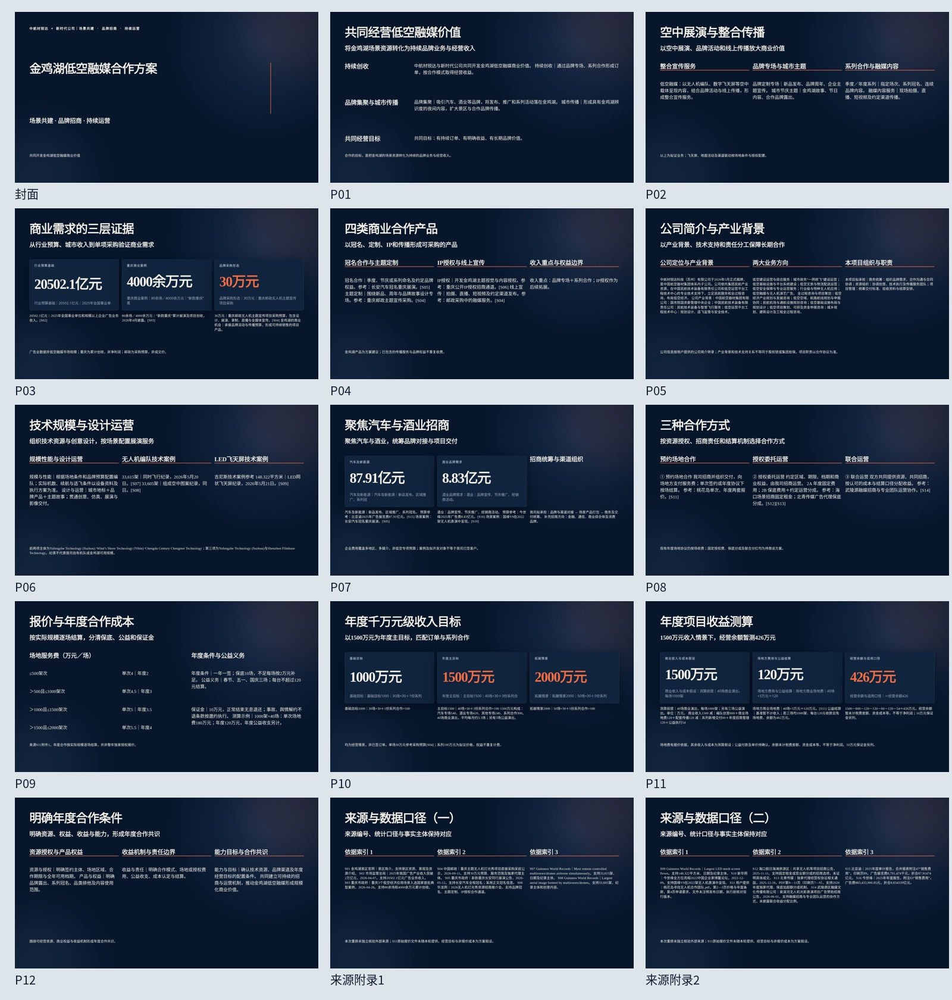

# 金鸡湖低空融媒合作方案｜深蓝杂志 HTML PPT

使用 dashi-ppt-skill 0.4.14、theme09 深蓝杂志主题制作。封面＋12页正文＋2页来源附录，共15页。正文恢复原大纲中的业务说明、机制参考、报价档位、成本假设及权益边界。公司简介采用用户提供的替换内容。

## 下载与打开

[下载 HTML 演示离线包](jinjihu-deep-blue-html.zip)

下载 ZIP，完整解压，打开 `jinjihu-deep-blue/index.html`。保持 `index.html` 与 `assets/` 在同一文件夹内。建议使用桌面 Chrome 或 Edge。

- 点击“演示 / Present”进入全屏演示，用左右方向键翻页，Esc 退出。
- 控制台可选页、编辑页面文字。离线修改后，请用页面的导出／保存功能另存文件；直接关闭不会自动写回原文件。
- GitHub 的 HTML 文件页面显示源码，不会直接执行演示；请下载完整离线包后打开。
- 可编辑 PPTX 导出依赖 dashi 本地 HTTP 服务，直接双击 HTML 时不提供该项保证；本次交付目标为 HTML 演示。

## 预览

[查看15页PDF](deep-blue-preview.pdf) · [查看全套缩略图](contact-sheet.jpg) · [HTML源文件](html/index.html)

## 内容说明

- 数字、来源编号及公司事实按用户材料转录；本轮未独立核验外部来源。
- S11原始报价文件未随本轮提供。场地报价以原大纲为依据，其他经营收入、价格和成本按方案假设呈现。
- 技术纪录采用完整主体署名与“技术案例参考”口径，未将纪录直接改写为公司自有机队能力。
- 聊天中提供的两张实拍图原文件未进入工作区，本版尚未嵌入；无生成图片冒充真实业绩。
- authoring/ 包含唯一内容源、生成计划和浏览器检查记录，便于继续修改。
