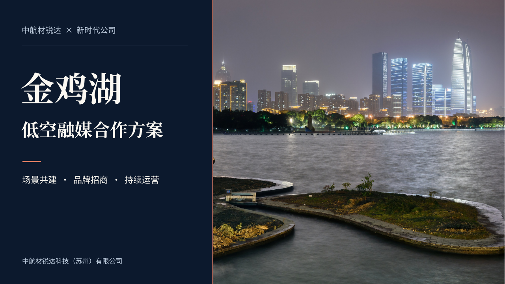
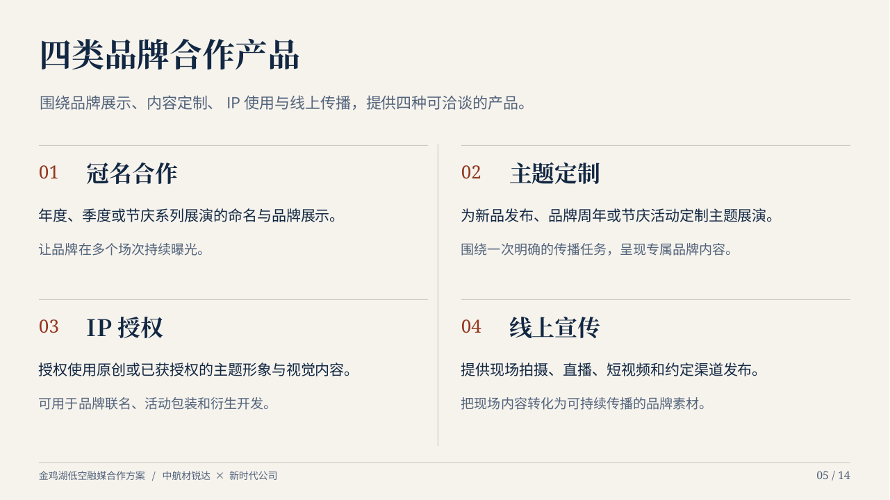
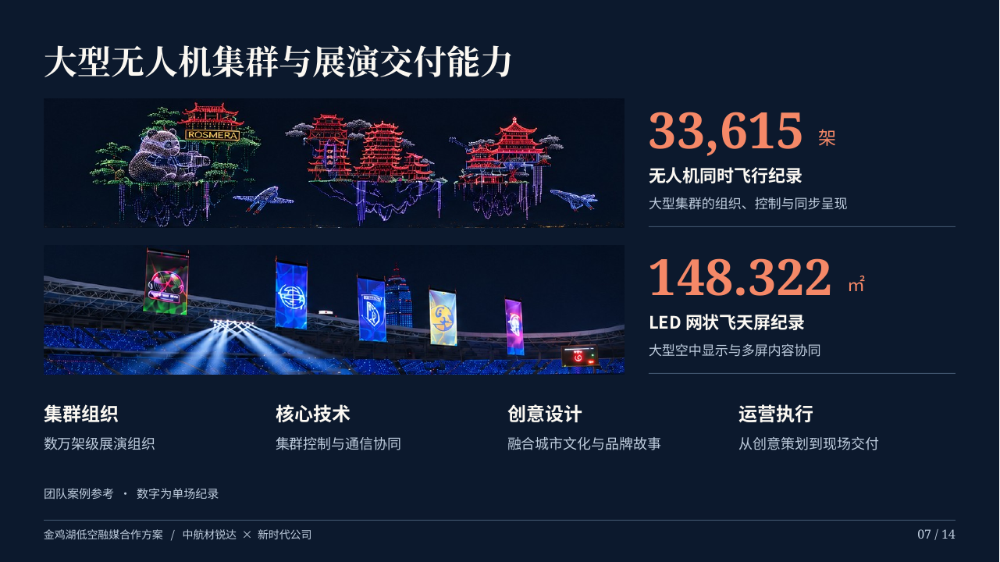
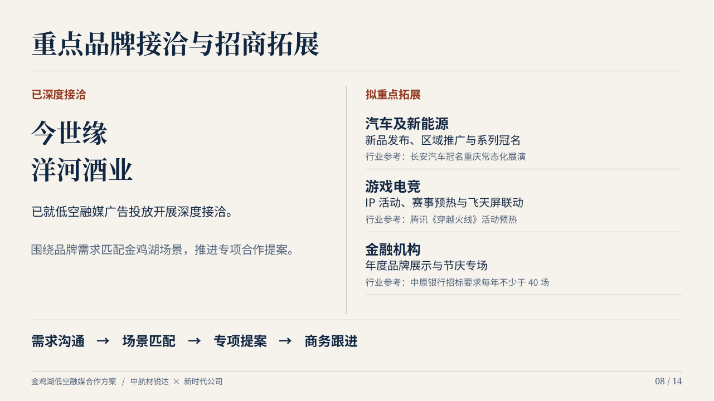
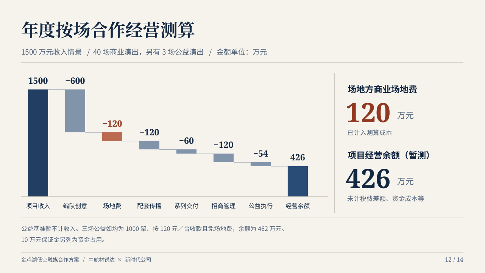

# 金鸡湖低空融媒合作方案 · 五页设计样张

[可编辑 PPTX](jinjihu-five-slide-demo.pptx) · [PDF 合集](jinjihu-five-slide-demo.pdf)

页码对应14页修订大纲。

## 01 · 封面

## 05 · 四类品牌合作产品

## 07 · 大型无人机集群与展演交付能力

## 08 · 重点品牌接洽与招商拓展

## 12 · 年度按场合作经营测算

封面金鸡湖夜景由 King of Hearts 摄影，排版使用裁切。裁切后的照片沿用 CC BY-SA 4.0。[照片原始页面](https://commons.wikimedia.org/wiki/File:Jinji_Lake_Suzhou_November_2017_002.jpg) · [许可条款](https://creativecommons.org/licenses/by-sa/4.0/)
