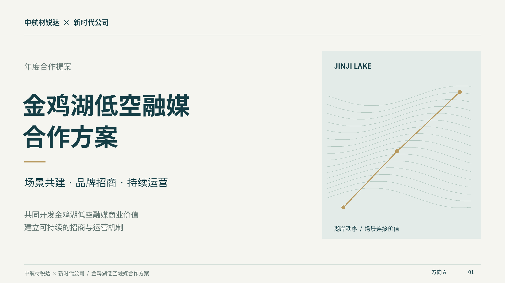
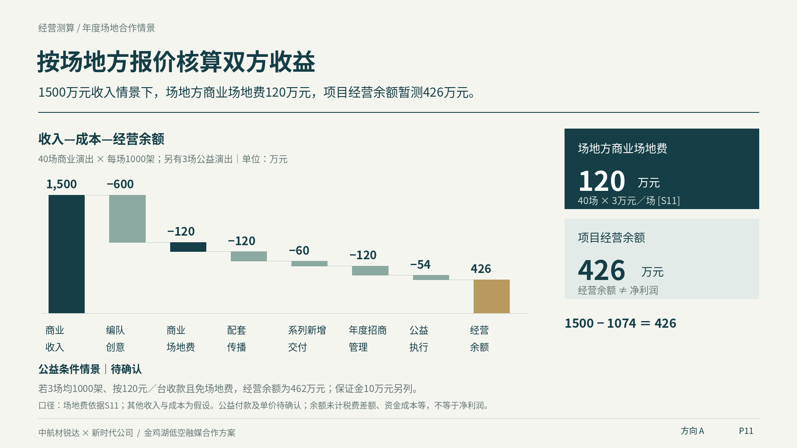
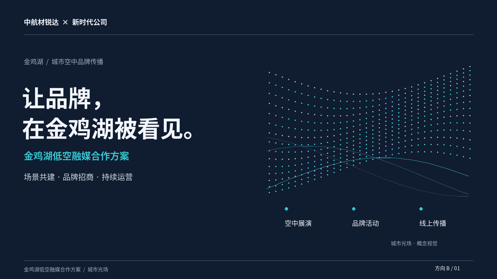
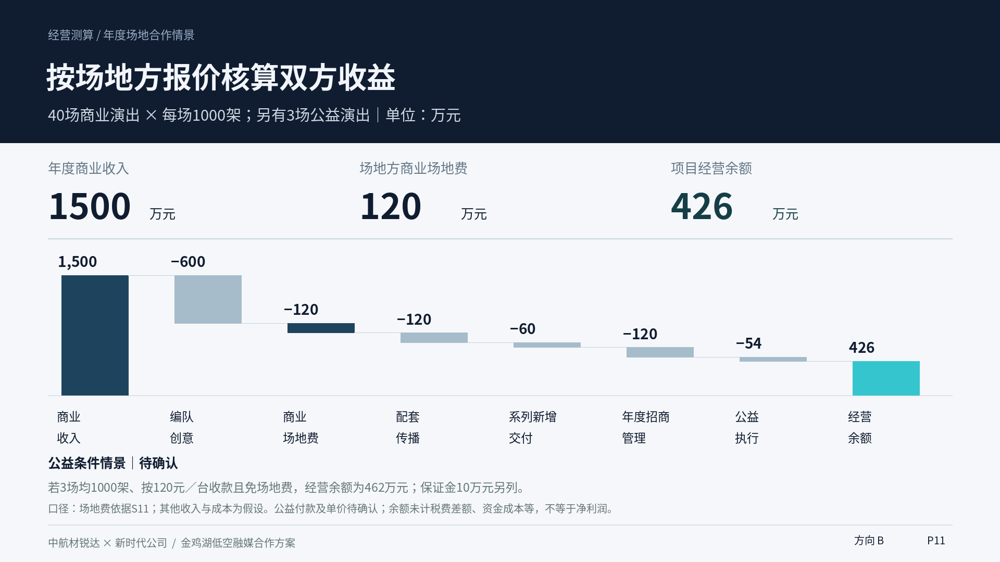
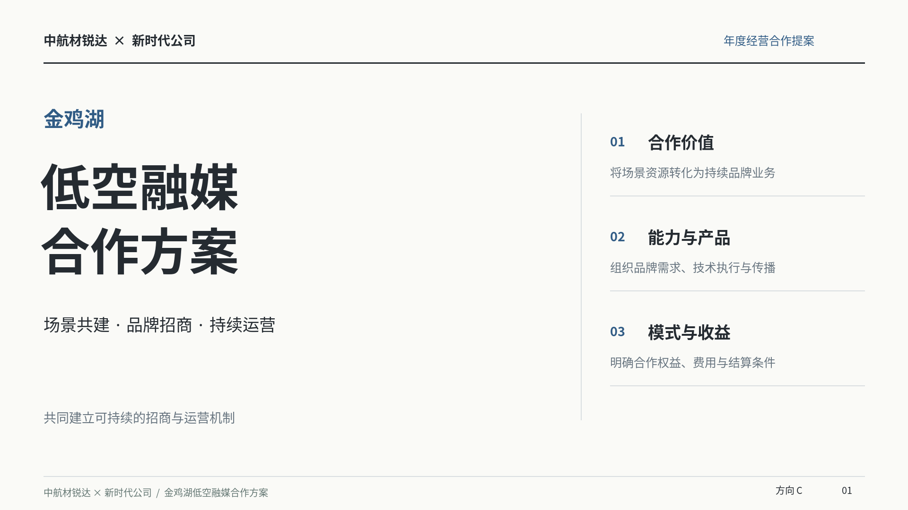
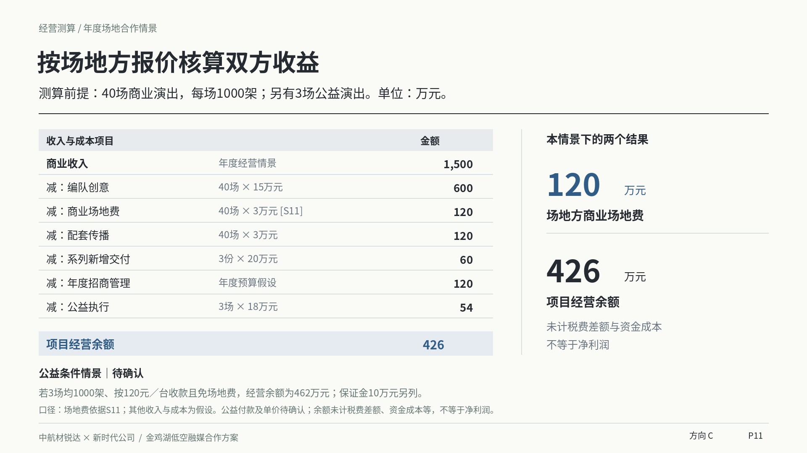

# 原始三个视觉方向 · 六张预览

本组不使用 dashi-PPT skill，按最初的三个方向独立制作。每个方向包含封面与正文 P11 收益测算页。

[六页 PDF 合集](six-previews.pdf)

## A 湖岸秩序

暖白、深青、香槟金；湖岸线与航点母题。

## B 城市光场

午夜蓝与清透青；封面以抽象光场表现空中传播，财务页切换浅底。图形为概念视觉，不代表实景或已落地项目。

## C 经营白皮书

纸白、石墨黑、沉稳蓝；编辑式标题与账本式明细，突出决策阅读。

金额及条件按用户提供的大纲转录，未独立核验原始S11。所有收益情景均非已签订单或利润保证。
